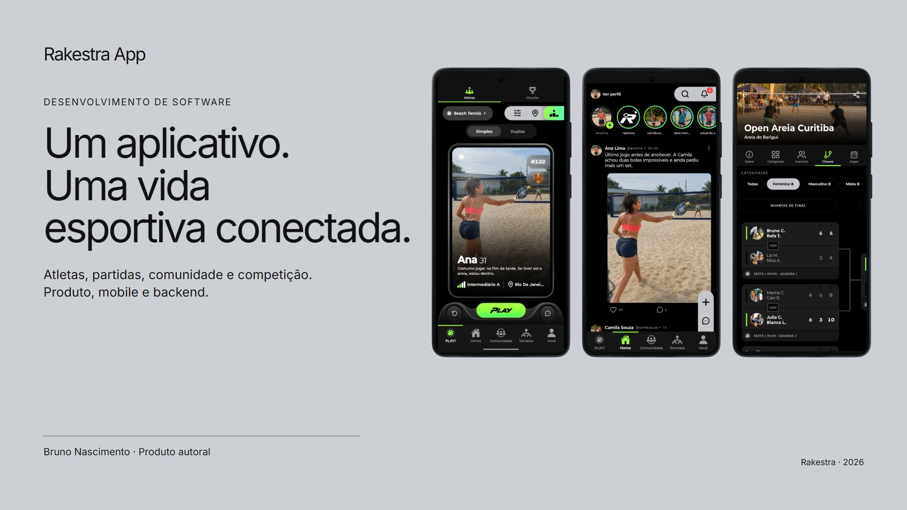

# Rakestra App

**Aplicativo para conectar atletas e organizar a vida esportiva em esportes de raquete.**



O produto reúne descoberta de parceiros, partidas, feed, mensagens, grupos, reservas, treinadores e torneios. Este repositório apresenta o conjunto e disponibiliza módulos reais de implementação, documentação e testes que podem ser executados sem acessar contas ou serviços do aplicativo.

**Bruno Nascimento:** concepção do produto, fluxos e direção visual. Construção com desenvolvimento assistido por IA, definição e revisão das funcionalidades. Bibliotecas e serviços utilizados conservam suas responsabilidades no sistema.

## Começar

Requisito: Node.js 24.12 ou superior. Os recortes usam a execução nativa de TypeScript do Node e não exigem instalação de pacotes.

```sh
npm test
npm run demo
```

O exemplo valida um pedido fictício em memória. Ele não envia convites, não inicia servidores e não se conecta ao banco. O comando de testes executa comportamento; não faz verificação estática de tipos.

## Conhecer o produto

| Área | Conteúdo |
|---|---|
| Atletas e partidas | Preferências, descoberta, proposta, resposta e histórico. |
| Vida social | Feed, stories, publicações, mensagens e notificações. |
| Comunidade | Grupos, clubes, vínculos e atividades. |
| Reservas | Espaços, disponibilidade e acompanhamento no aplicativo. |
| Treinadores e alunos | Perfil, serviços, agenda e acompanhamento. |
| Competição | Torneios, categorias, confrontos e resultados. |
| Perfil e evolução | Identidade esportiva, histórico e conquistas. |

Veja o [guia dos módulos](docs/modules/README.md), a [arquitetura](docs/architecture/README.md) e a [apresentação completa](docs/product.md).

## Examinar a engenharia

- [Conferir um convite após uma interrupção](docs/decisions/convites.md).
- [Validar a identidade e o significado dos dados](docs/decisions/identidade.md).
- [Separar aceite parcial de confirmação](docs/decisions/notificacoes.md).
- [Conservar a sessão no armazenamento protegido](docs/decisions/sessao.md).

O código em [src](src) conserva a lógica dos módulos originais. As adaptações de caminhos e os hashes estão em [sources.json](sources.json). O repositório é uma edição técnica para portfólio; não contém todo o aplicativo, a API ou um ambiente completo de produção.

## Evidências e estado

Em 04/11/2026, os **17 testes passaram** localmente com Node.js 24.14.0. O [registro da execução](evidence/verification.json) identifica a abrangência. Oito testes exercitam a política de sessão com adaptadores controlados; nove verificam contratos e apresentação de dados.

Esses testes não representam uma auditoria geral de segurança, uma prova ponta a ponta no aparelho ou validação dos demais módulos. As telas em [media](media) apresentam cenários demonstrativos do desenvolvimento em 2026, com personagens e indicadores fictícios. Algumas conservam a identidade PlayZone utilizada durante o desenvolvimento.

## Organização

| Caminho | Material |
|---|---|
| docs/product.md | Produto completo e conexões entre os módulos. |
| docs/modules | Responsabilidades e referências de cada área. |
| docs/architecture | Partes do sistema e limites desta edição. |
| docs/decisions | Problemas, escolhas e consequências documentadas. |
| src | Módulos extraídos do produto. |
| tests | Testes de comportamento executáveis. |
| examples | Validação de um pedido fictício. |
| evidence | Escopo e resultado das verificações. |

[Portfólio de Bruno Nascimento](https://bruniversamente.github.io/)

## Verificação adicional do fluxo original

A execução de `scripts/match-proposal-creation.test.cjs` nos arquivos originais do produto passou em **15 testes** em 04/11/2026. A suíte utiliza API e armazenamento controlados para provocar resposta perdida, reinício do módulo, concorrência e troca de conta. O [registro TAP](evidence/original-proposal-flow.tap) conserva os cenários e resultados. Essa execução é separada dos 17 testes reproduzíveis deste pacote e não comprova a transação do banco nem o percurso no aparelho.
