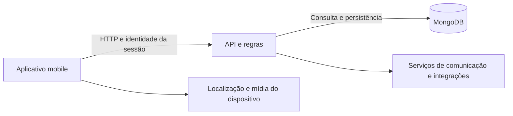
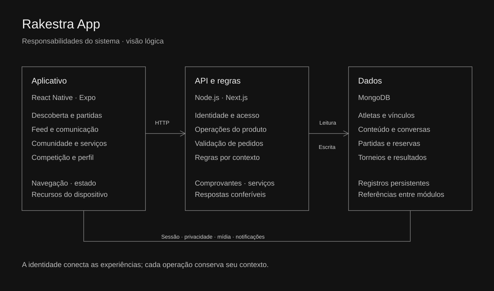
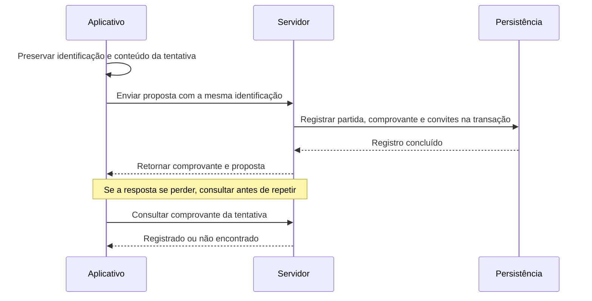

# Arquitetura

O Rakestra App utiliza React Native, Expo e TypeScript. Serviços do cliente ligam a interface à API em Node.js/Next.js; o MongoDB persiste os registros. O desenho abaixo é uma visão lógica, sem declarar a topologia ou a capacidade de produção.

## Limites e referências

- O aplicativo mantém navegação e estado de apresentação. A política de acesso a uma operação também precisa existir no servidor.
- Atleta, grupo, clube, partida, reserva e torneio são contextos relacionados. O perfil não substitui um vínculo com um grupo, e um convite não equivale a uma partida realizada.
- Algumas operações se conectam ao Rakestra Gestão. A apresentação deste repositório acompanha o aplicativo; a implementação do sistema de gestão tem escopo próprio.
- Os módulos publicados em src não incluem a comunicação com APIs, o banco ou as dependências de React Native. Sua execução permite verificar funções selecionadas.

## Conexão do convite

Este fluxo documenta o mecanismo encontrado no código. Os testes desta edição verificam contratos e identidade; a transação completa depende de seu próprio ambiente de integração.
