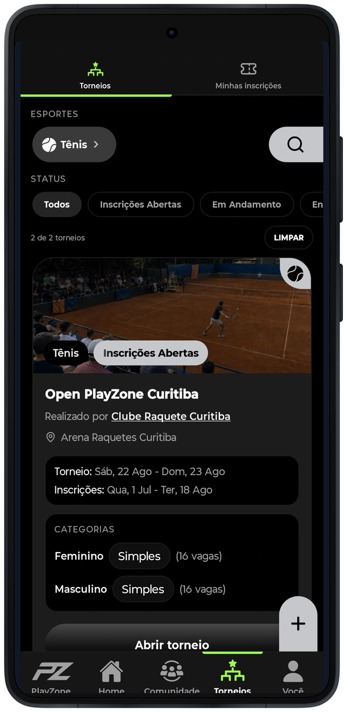
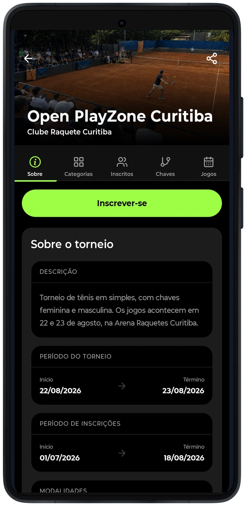
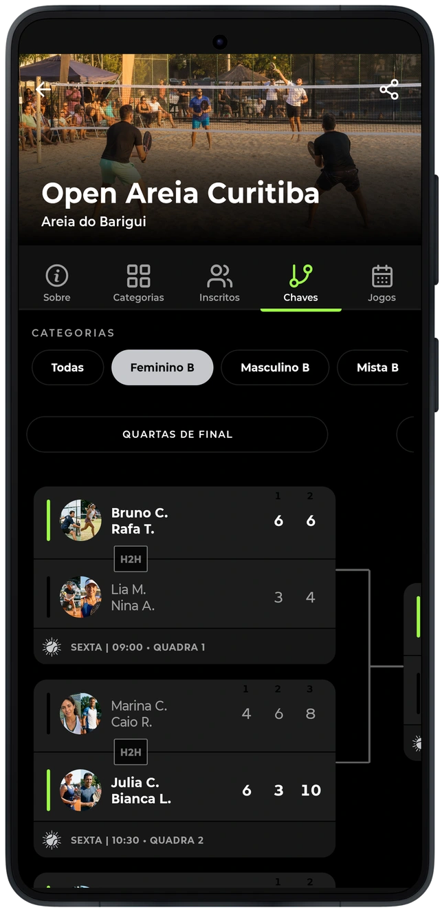

# Do interesse pela competição ao acompanhamento dos jogos

Os torneios reúnem informações da competição, categorias, participantes, confrontos e resultados. O aplicativo oferece a consulta e a participação nesse contexto, com navegação entre as partes do evento.
Uma inscrição, a presença de um participante na chave e o resultado de um confronto representam etapas diferentes. A organização do software precisa conservar essas relações para que a pessoa reconheça sua participação e acompanhe a competição.

As telas mostram competições e resultados fictícios preparados para apresentação. Não representam torneios realizados, volume de inscritos reais ou resultados comerciais do produto.
