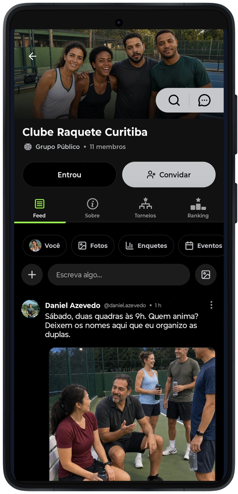
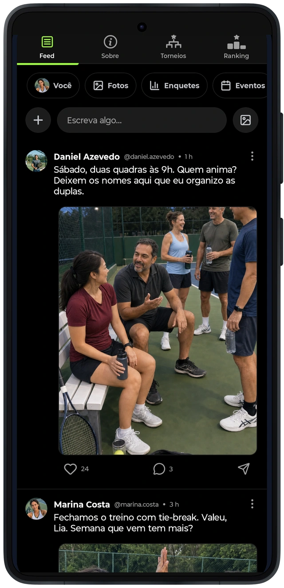
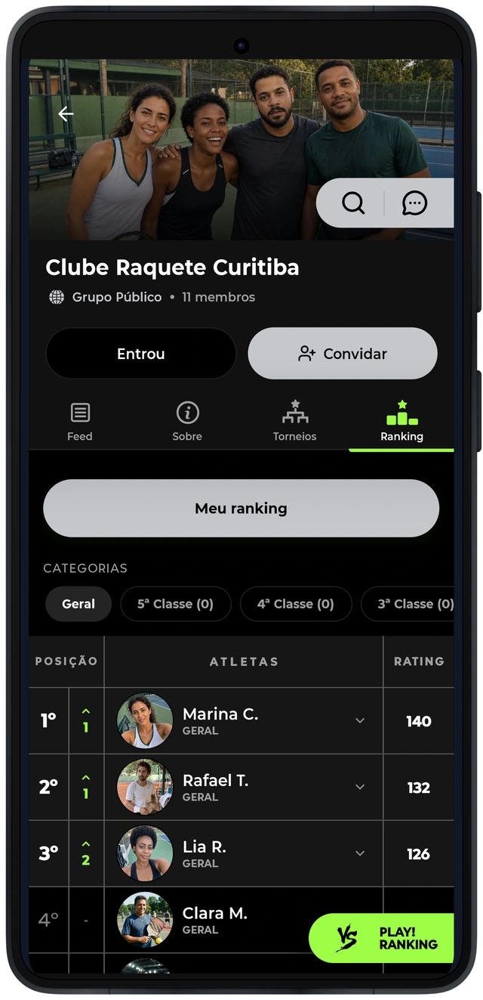

# Uma identidade compartilhada para jogar

Os grupos organizam relações que vão além de um encontro individual. Identidade, participantes, publicações, conversa e atividades esportivas ficam reunidos num contexto comum. Clubes e espaços acrescentam a ligação com a prática organizada.
Essa estrutura exige distinguir o perfil da pessoa, seu vínculo com o grupo e as funções que ela pode exercer naquele contexto. Uma mesma identidade pode aparecer como participante, autora de conteúdo ou integrante de uma atividade, sem transformar esses papéis em equivalentes.

As ligações entre comunidade, competição e perfil fazem parte do mapa do produto. O ranking do grupo conserva seu contexto; ele não deve ser confundido com qualquer outro indicador esportivo exibido no aplicativo.
