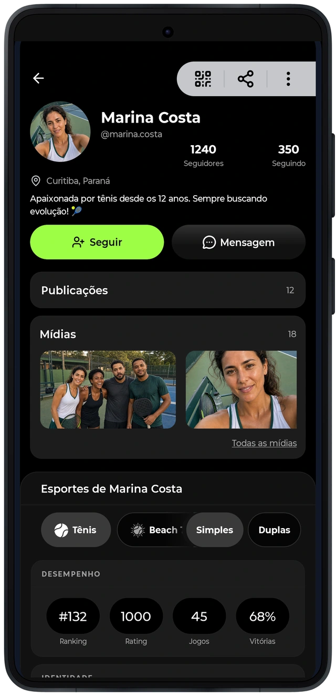
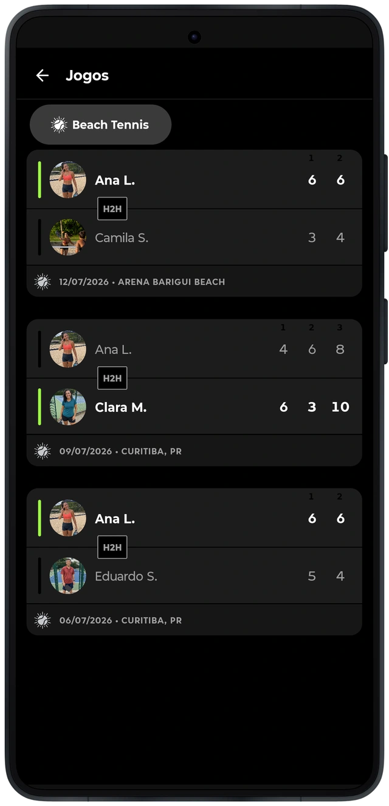
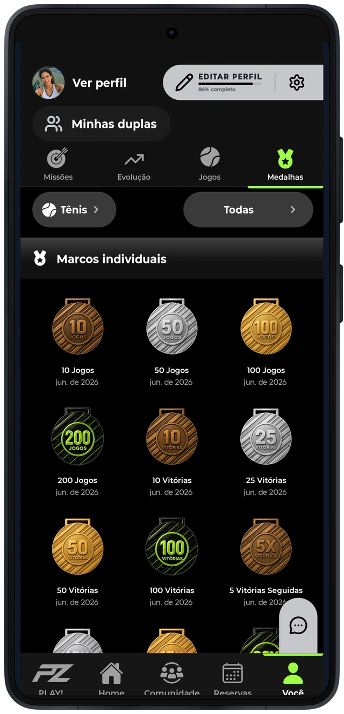

# Uma trajetória que atravessa os módulos

O perfil reúne a identidade esportiva, as relações, as partidas e as conquistas apresentadas pelo aplicativo. Ele funciona como ponto de consulta para informações que também aparecem na descoberta, nas conversas e nas atividades.
Os indicadores precisam conservar o contexto de modalidade, formato e origem. Consultar um histórico é diferente de confirmar um resultado; apresentar uma conquista é diferente de comprovar que uma operação foi concluída.

Os módulos extraídos para o repositório incluem leitores e validadores utilizados para conferir identidades e dados de partidas. Eles permitem examinar uma parte dessa fronteira entre o que o aplicativo recebe e o que aceita apresentar.
