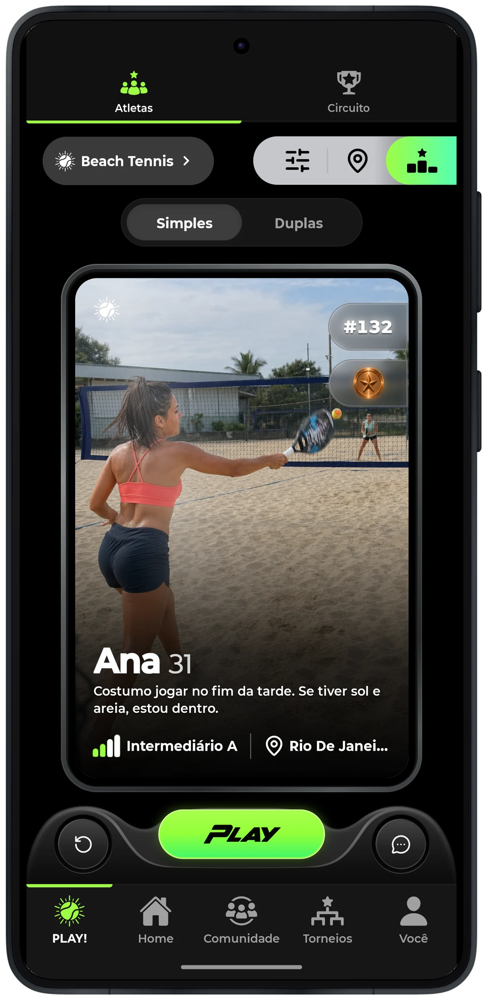
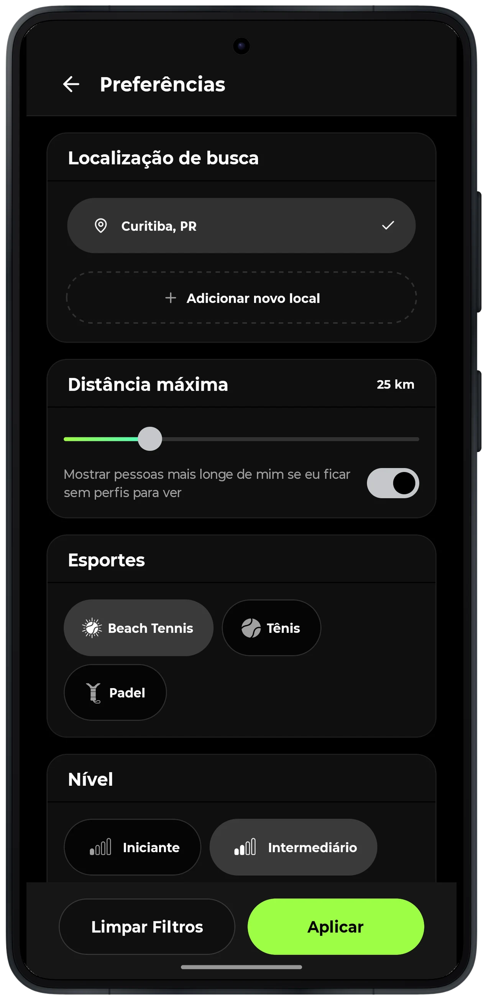
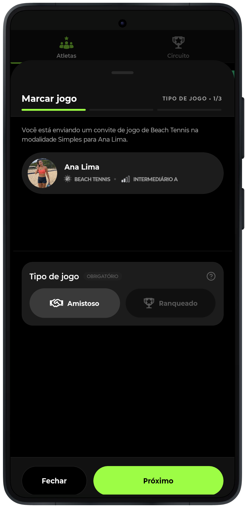
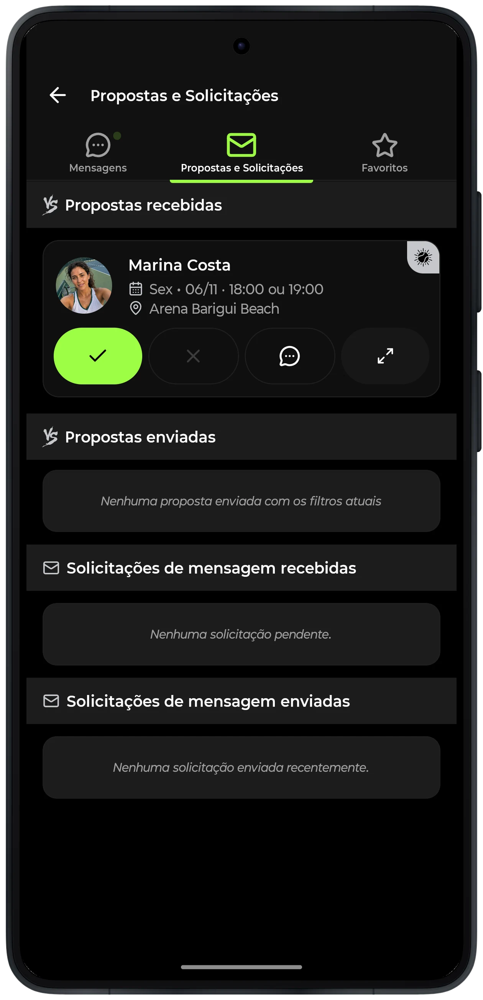
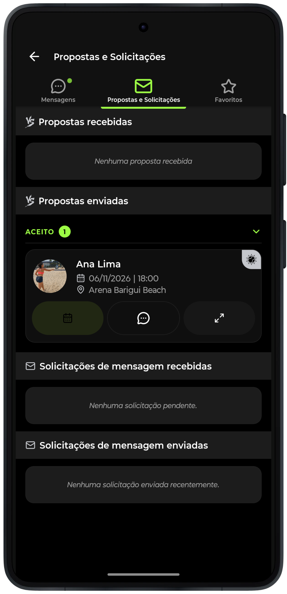
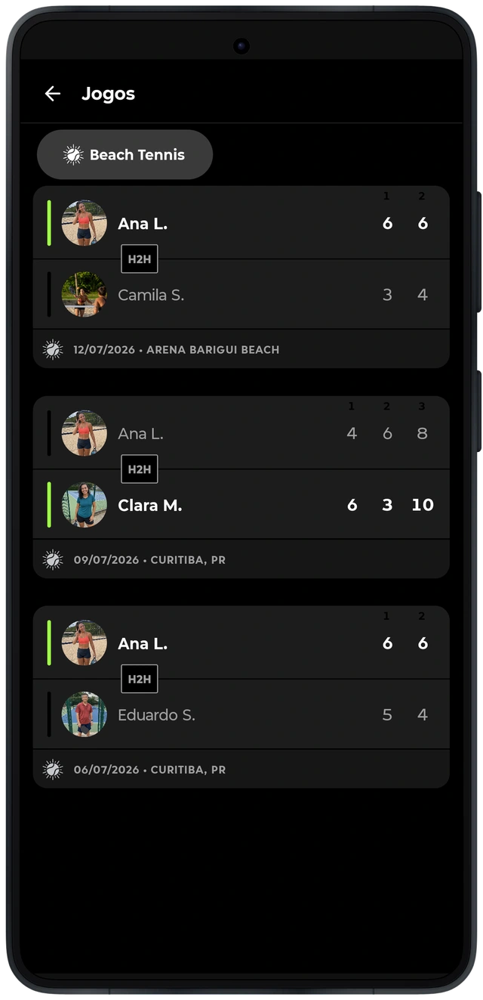

# Encontrar um parceiro e organizar o encontro

A descoberta começa pela modalidade, pelas preferências e pela localização. Cartões e mapa oferecem formas de explorar atletas e consultar seu contexto antes do contato. O servidor considera os critérios da busca e as regras de visibilidade; o aplicativo organiza o retorno para a apresentação.
O convite reúne participantes, tipo de jogo, data e local. O recebimento e a resposta dão continuidade à proposta. A agenda e o histórico representam momentos distintos dessa relação: um convite enviado ainda não significa uma partida aceita ou realizada.

As etapas compartilham identidades de atleta e partida. O aplicativo mantém essas referências ao trocar de tela e trata carregamento, ausência de candidatos, erros de consulta e propostas pendentes com estados próprios.

