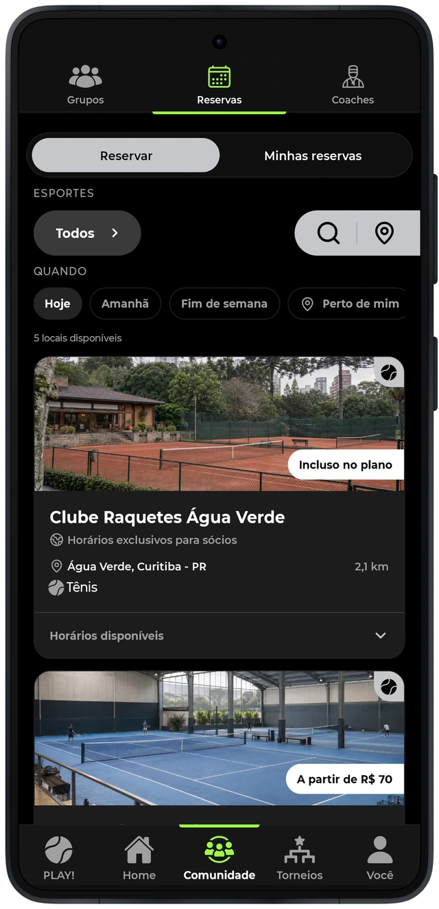
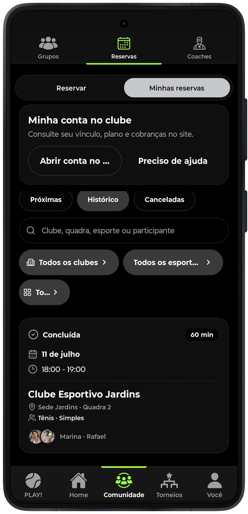

# Conectar a intenção de jogar a um espaço

A área de reservas permite explorar espaços por modalidade e consultar a oferta disponível. O atleta acompanha suas reservas na experiência mobile, enquanto a operação do estabelecimento se relaciona com o Rakestra Gestão.
O contexto da reserva precisa permanecer associado ao espaço, ao participante, ao horário e à situação apresentada. Reserva, presença e cobrança representam informações diferentes; a interface deve permitir reconhecer o significado de cada uma.

Neste projeto, o foco é a participação do atleta pelo aplicativo e a conexão com os dados da operação. O case específico do Rakestra Gestão aprofunda a experiência de atendimento e organização do clube.
