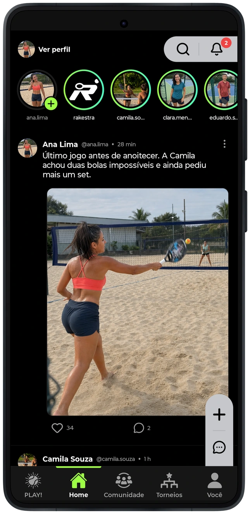
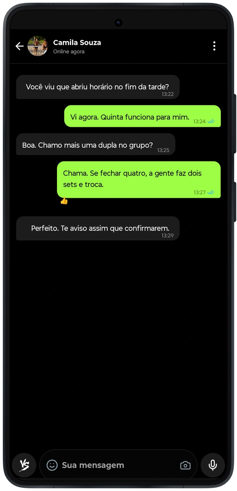
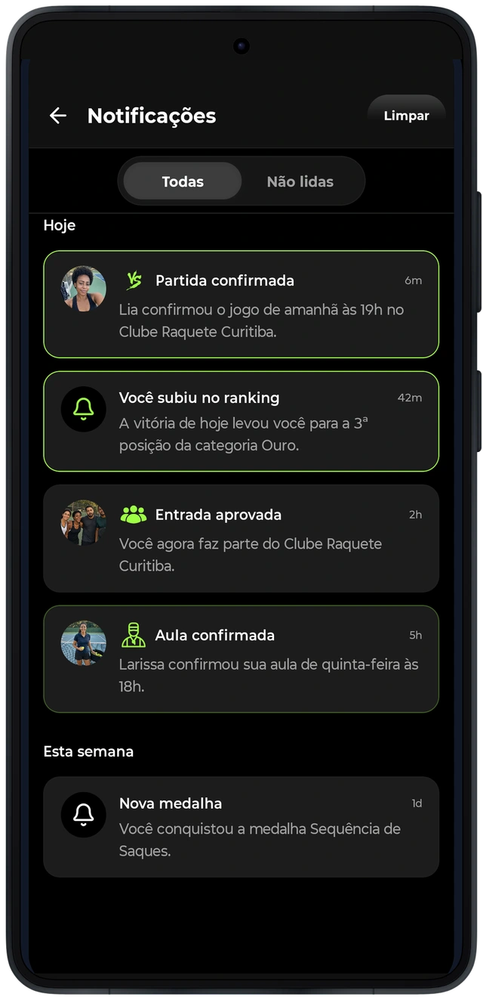

# A relação continua entre as partidas

O feed e os stories permitem compartilhar a prática esportiva. Publicações e perfis oferecem contexto para conhecer outras pessoas; as conversas permitem alinhar os detalhes do encontro. As notificações direcionam a atenção para atividades e respostas relacionadas ao usuário.
No software, conteúdo, autoria, participantes e atividade de origem precisam conservar suas referências. As permissões e os bloqueios acompanham essas interações, além do que aparece na composição visual de uma tela.

A captura registra a aparência do cenário demonstrativo. Ela não comprova entrega de mensagens ou notificações em produção. As verificações reproduzíveis desta edição técnica estão identificadas no capítulo de qualidade.
