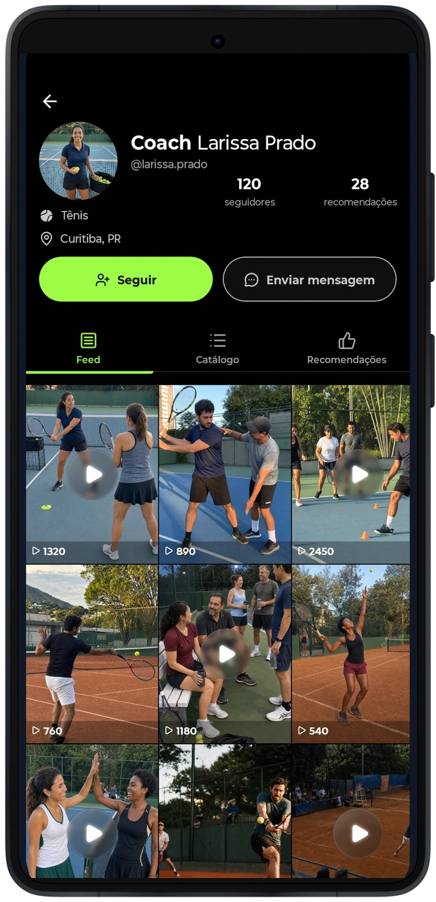
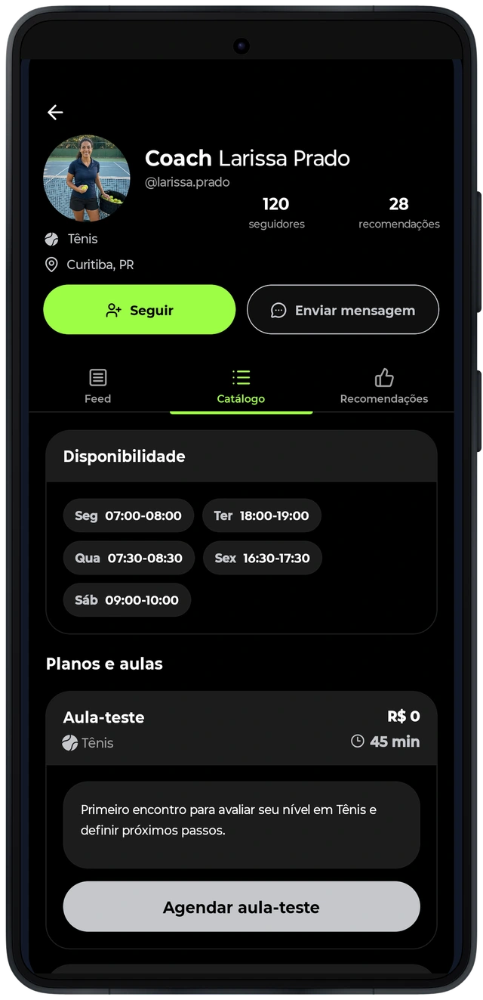
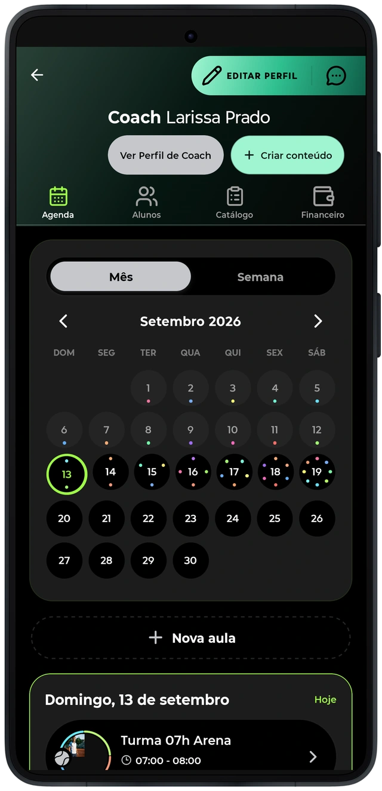
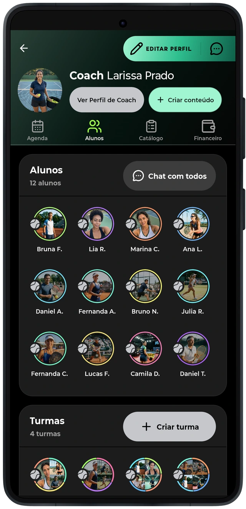

# O mesmo aplicativo, responsabilidades diferentes

O perfil do treinador reúne identidade profissional, conteúdo e catálogo de serviços. Para o aluno, essa apresentação ajuda a conhecer a oferta e iniciar o contato ou o agendamento disponível.
O profissional também tem uma área de trabalho no aplicativo: agenda, serviços e acompanhamento de alunos. A navegação precisa conservar a identidade da pessoa e distinguir as responsabilidades de quem procura uma aula e de quem organiza o atendimento.

Os valores e os compromissos das capturas pertencem ao cenário demonstrativo. A apresentação do painel evidencia a abrangência do produto; a prontidão de cada operação exige verificações próprias.
